<p align="center">
  
</p>

<p align="center">
  <strong>Adaptive runtime middleware for AI agents</strong><br>
  Hardware-aware model routing · Verified tool execution · Performance-driven optimization
</p>

<p align="center">
  <a href="https://github.com/FlashSpeedie/SidWeave/actions/workflows/ci.yml">
    
  </a>
  <a href="https://github.com/FlashSpeedie/SidWeave/blob/main/LICENSE">
    
  </a>
  <a href="https://python.org">
    
  </a>
  <a href="https://github.com/FlashSpeedie/SidWeave/releases">
    
  </a>
</p>

---

## What It Does

SidWeave sits between your AI agent and model providers, making existing agents more capable without requiring replacement.

- **Hardware-aware model selection** – Detects CPU, GPU, memory, and inference backends to choose models that fit your hardware
- **Adaptive routing** – Selects the best model for each task based on capabilities, historical performance, latency, cost, and hardware constraints
- **Verified execution** – MCP tool integration with precondition validation, postcondition verification, idempotency, and recovery
- **OpenAI-compatible API** – Drop-in replacement for existing OpenAI clients
- **Local-first** – Runs entirely on your machine with Ollama; cloud providers optional

## Quick Start

```powershell
# Install
pip install -e .

# Initialize configuration
sidweave init

# Verify setup
sidweave doctor

# Discover models
sidweave models list

# Start API server
sidweave serve
```

API available at `http://127.0.0.1:8765/v1` (OpenAI-compatible).

Connect your existing agent:

```python
import openai

client = openai.OpenAI(
    base_url="http://127.0.0.1:8765/v1",
    api_key="not-needed"  # Local-only usage
)

response = client.chat.completions.create(
    model="",  # Empty string triggers auto-routing
    messages=[{"role": "user", "content": "Hello!"}]
)
```

See [Quick Start Guide](docs/QUICKSTART.md) for detailed instructions.

## Architecture

```mermaid
flowchart TD
    subgraph EXT["Existing AI Agents / Applications"]
        Agent1["OpenAI-compatible Client<br/>(OpenAI SDK, LangChain,<br/>LiteLLM, custom)"]
        Agent2["MCP-enabled Agent<br/>(if configured)"]
    end

    subgraph API["SidWeave API Gateway<br/>(FastAPI, OpenAI-compatible)"]
        direction TB
        Health["GET /health"]
        Models["GET /v1/models"]
        Chat["POST /v1/chat/completions"]
        Route["POST /v1/sidweave/route"]
        Hardware["GET /v1/sidweave/hardware"]
        Providers["GET /v1/sidweave/providers"]
        Profile["POST /v1/sidweave/models/{name}/profile"]
    end

    subgraph CORE["SidWeave Runtime"]
        direction TB
        Router["Adaptive Routing Engine<br/>- Strategy: balanced/latency/cost/quality/local_first<br/>- Capability filtering<br/>- Hardware scoring<br/>- Historical performance"]
        HardwareProfiler["Hardware Profiler<br/>- CPU/GPU/Memory detection<br/>- Inference backends<br/>- Periodic re-profiling"]
        ModelRegistry["Model Registry<br/>- Ollama sync<br/>- NVIDIA NIM sync<br/>- Capability estimation<br/>- Profiling & persistence"]
        ExecEngine["Verified Execution Engine<br/>- Precondition validation<br/>- Postcondition verification<br/>- Idempotency keys<br/>- Approval workflow<br/>- Reconciliation"]
        ProviderGateway["Provider Gateway<br/>- Health monitoring<br/>- Fallback routing<br/>- Request dispatch"]
        LearningEngine["Learning Engine<br/>- Outcome recording<br/>- Performance reports<br/>- Routing recommendations"]
    end

    subgraph STORAGE["SQLite Storage"]
        direction TB
        ModelsDB[(Models<br/>+ capabilities<br/>+ measurements)]
        RoutingDB[(Routing decisions<br/>+ scores)]
        ExecDB[(Tool executions<br/>+ verification)]
        BenchmarkDB[(Benchmark runs)]
        HardwareDB[(Hardware profiles)]
    end

    subgraph LOCAL["Local Provider (Required)"]
        Ollama["Ollama<br/>- Local models<br/>gemma:2b, llama3.1, etc.<br/>- No API key needed"]
    end

    subgraph CLOUD["Cloud Providers (Optional)"]
        NVIDIA["NVIDIA NIM<br/>- 20+ models<br/>- Requires NVIDIA_API_KEY"]
        OpenAI["OpenAI<br/>- GPT models<br/>- Requires OPENAI_API_KEY"]
        Anthropic["Anthropic<br/>- Claude models<br/>- Requires ANTHROPIC_API_KEY"]
        OpenRouter["OpenRouter<br/>- 100+ models<br/>- Requires OPENROUTER_API_KEY"]
    end

    Telemetry["OpenTelemetry<br/>- Custom metrics<br/>- Traces<br/>- OTLP export"]

    Agent1 -->|"OpenAI API<br/>base_url=http://localhost:8765/v1"| Chat
    Agent2 -->|"MCP Protocol"| ExecEngine
    
    Chat -->|"1. Route request"| Router
    Chat -->|"2. Execute via provider"| ProviderGateway
    
    Route --> Router
    Hardware --> HardwareProfiler
    Providers --> ProviderGateway
    Profile --> ModelRegistry
    
    Router -->|"Available models<br/>+ capabilities"| ModelRegistry
    Router -->|"Hardware profile"| HardwareProfiler
    Router -->|"Historical perf."| ModelsDB
    
    ProviderGateway -->|"Healthy providers"| Router
    ProviderGateway -->|"Dispatch request"| Ollama
    ProviderGateway -.->|"If enabled & configured"| NVIDIA
    ProviderGateway -.->|"If enabled & configured"| OpenAI
    ProviderGateway -.->|"If enabled & configured"| Anthropic
    ProviderGateway -.->|"If enabled & configured"| OpenRouter
    
    ModelRegistry -->|"Sync models"| Ollama
    ModelRegistry -.->|"Sync models"| NVIDIA
    ModelRegistry -->|"Persist"| ModelsDB
    
    Router -->|"Record decision"| RoutingDB
    ExecEngine -->|"Record execution"| ExecDB
    LearningEngine -->|"Read outcomes"| ExecDB
    LearningEngine -->|"Read routing"| RoutingDB
    HardwareProfiler -->|"Store profile"| HardwareDB
    
    Chat -.->|"Metrics + traces"| Telemetry
    Router -.->|"Metrics"| Telemetry
    ProviderGateway -.->|"Metrics"| Telemetry
    ExecEngine -.->|"Metrics"| Telemetry

    classDef agent fill:#1E293B,color:#F8FAFC,stroke:#334155,stroke-width:2px
    classDef api fill:#0F172A,color:#F8FAFC,stroke:#2563EB,stroke-width:2px
    classDef core fill:#0F172A,color:#F8FAFC,stroke:#7C3AED,stroke-width:2px
    classDef provider fill:#0F172A,color:#F8FAFC,stroke:#DB2777,stroke-width:2px
    classDef storage fill:#0F172A,color:#F8FAFC,stroke:#059669,stroke-width:2px
    classDef optional fill:#1E293B,color:#94A3B8,stroke:#475569,stroke-width:1px,stroke-dasharray: 5 5
    classDef external fill:#1E293B,color:#94A3B8,stroke:#475569,stroke-width:1px

    class Agent1,Agent2 agent
    class Health,Models,Chat,Route,Hardware,Providers,Profile api
    class Router,HardwareProfiler,ModelRegistry,ExecEngine,ProviderGateway,LearningEngine core
    class ModelsDB,RoutingDB,ExecDB,BenchmarkDB,HardwareDB storage
    class Ollama provider
    class NVIDIA,OpenAI,Anthropic,OpenRouter optional
```



[View full architecture documentation](docs/architecture/README.md)

## Existing Agent Integration

Connect your existing OpenAI-compatible agent in seconds. Only the client configuration changes.

```python
import openai

client = openai.OpenAI(
    base_url="http://127.0.0.1:8765/v1",
    api_key="not-needed"  # Local-only
)

# Empty string triggers SidWeave's adaptive routing
response = client.chat.completions.create(
    model="",
    messages=[{"role": "user", "content": "Write a Python function to reverse a string"}]
)
```

- Works with **OpenAI SDK**, **LangChain**, **LiteLLM**, and any OpenAI-compatible client
- Agent logic stays identical – only `base_url` and `api_key` change
- SidWeave handles model selection, routing, fallbacks, and MCP tool execution

See [complete example](examples/existing_agent/) with runnable code, streaming, and multi-turn conversations.

## Provider Configuration

| Variable | Default | Description |
|----------|---------|-------------|
| `SIDWEAVE_PROVIDER_OLLAMA_HOST` | `http://localhost:11434` | Ollama endpoint |
| `SIDWEAVE_PROVIDER_ENABLE_CLOUD_PROVIDERS` | `false` | Enable cloud providers |
| `NVIDIA_API_KEY` | – | NVIDIA NIM API key |
| `NVIDIA_BASE_URL` | `https://integrate.api.nvidia.com/v1` | NVIDIA NIM endpoint |
| `OPENAI_API_KEY` | – | OpenAI API key |
| `ANTHROPIC_API_KEY` | – | Anthropic API key |
| `OPENROUTER_API_KEY` | – | OpenRouter API key |

**Important**: API keys are supplied by you. Consumer ChatGPT or Claude subscriptions do not automatically provide API credentials. You need platform API keys from each provider.

## Routing Strategies

| Strategy | Behavior |
|----------|----------|
| `balanced` | Balance latency, cost, quality (default) |
| `latency` | Minimize response time |
| `cost` | Minimize cost (prefers local) |
| `quality` | Maximize throughput/accuracy |
| `local_first` | Prefer local models |

## Commands

```bash
sidweave init                    # Initialize configuration
sidweave doctor                  # Run diagnostics
sidweave serve                   # Start runtime server
sidweave status                  # Show runtime status
sidweave models list             # List available models
sidweave models profile llama3.1:8b  # Profile a model
sidweave models stats gpt-4o     # Show model statistics
sidweave route coding            # Test routing for coding tasks
sidweave route reasoning --capabilities "reasoning"  # Test with capabilities
sidweave benchmark my-benchmark --compare  # Baseline vs SidWeave
sidweave benchmark my-benchmark --mode sidweave --tasks "quick"  # Quick benchmark
sidweave benchmark my-benchmark --task-file ./custom-tasks.json  # Custom tasks
sidweave config --show           # Show current configuration
sidweave config --edit           # Edit configuration in $EDITOR
```

## Current Limitations

| Category | Limitation |
|----------|------------|
| **Supported Python** | 3.12+ (3.13 in CI) |
| **Operating Systems** | Windows (primary), Linux/macOS (CI only, unverified locally) |
| **Local Provider** | Ollama required for local inference |
| **Cloud Providers** | Optional; each requires its own API key |
| **Model Discovery** | NVIDIA NIM models filtered for chat compatibility (some return 404) |
| **Auto-Routing** | Local-first fallback works; explicit cloud model requests bypass routing |
| **SQLite Connections** | Cosmetic cleanup warnings on shutdown (no functional impact) |
| **Benchmarks** | Small sample size (3 tasks) – not statistically significant |
| **MCP Integration** | Precondition/postcondition verification implemented; reconciliation on ambiguous outcomes |
| **Telemetry** | OpenTelemetry enabled by default; OTLP export configurable |
| **Persistence** | SQLite with 7 tables; WAL mode enabled |

**Do not claim production readiness without evidence.** This is an alpha release (v0.1.0).

## Development

```bash
# Clone and setup
git clone https://github.com/FlashSpeedie/SidWeave.git
cd SidWeave

# Install with dev dependencies
uv pip install -e ".[dev]"

# Run tests
pytest

# Lint
ruff check src/

# Type check
mypy src/sidweave
```

## Requirements

- Python 3.12+
- Ollama (for local models)
- Optional: API keys for cloud providers (NVIDIA NIM, OpenAI, Anthropic, OpenRouter)

## Roadmap

- Learned routing policies from execution history
- LoRA/QLoRA experimentation framework
- Preference optimization (DPO, GRPO)
- Additional agent integrations
- Distributed inference support

## License

MIT License – see [LICENSE](LICENSE) for details.

## Contributing

See [CONTRIBUTING.md](CONTRIBUTING.md) for guidelines.

## Security

See [SECURITY.md](SECURITY.md) for security policy and reporting.

## Links

- Repository: https://github.com/FlashSpeedie/SidWeave
- Issues: https://github.com/FlashSpeedie/SidWeave/issues
- Discussions: https://github.com/FlashSpeedie/SidWeave/discussions